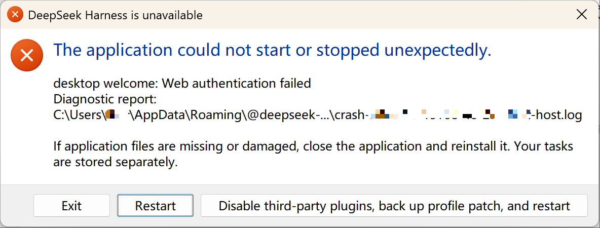

# dsh-easy2restart


DSH 重启 + 安全归档插件。`0.2.0` 起由 `dsh-plugin-easy2restart` 与 `dsh-plugin-safe-archive` 合并而来，`0.2.1` 完成界面重做与「自动备份」可配置化。

> **📦 包名 / 仓库已改名**
> 旧：`dsh-plugin-easy2restart`（GitHub 同名仓库）+ `dsh-plugin-safe-archive` → 新：**`dsh-easy2restart`**
> 旧包仍可安装但不再更新，请迁移到新包，详见 [RENAME.md](./RENAME.md)。

- **重启**：侧边栏底部「重启」按钮，双击即整进程重启 DeepSeek Harness；会话运行中自动置灰。
- **安全归档**：任何归档入口先弹确认框；会话仍在活动时给出活动清单 + 10 秒倒计时，倒计时结束才能「停止并归档」。
- **归档即备份**：归档成功后宿主在 3 秒后自动备份会话文件、附件、标题缓存与元数据；备份目录**可在界面里改，也能整个关掉**。
- **右侧栏「已归档会话」**：以归档会话文件夹为根的文件树，可在资源管理器中直接定位。

## ⚠️ 已知 DSH 启动问题（与本插件无关）

**现象｜Symptom**



启动 DSH 时弹出上面这个窗口：「The application could not start or stopped unexpectedly.」，正文是 `desktop welcome: Web authentication failed`，并附诊断日志路径（`%APPDATA%\@deepseek-ai\dsh-desktop\logs\` 下的 crash/host 日志）；按钮为 `Exit` / `Restart` / `Disable third-party plugins, back up profile patch, and restart`。主界面进不去，日志目录里每次多一条 `phase: startup` 的崩溃记录。

**原因｜Cause**

每次启动 DSH 都会向桌面 cookie 库新增一条 `dsh-auth-*` cookie（127.0.0.1、每次启动端口随机，所以 cookie 名不同、不会覆盖旧条目）。它的有效期是 **30 天**，30 天内不会自己消失；累积到 **71 条**时 Cookie 请求头超过 16 KB 上限，host 返回 **431**，桌面握手失败 —— 就是上面这个弹窗。所以**重启越频繁，越快撞线**：一天重启几次的话，大约一个月内必然出现。

**为什么点「Disable…」没用｜Why the "Disable" button doesn't help**

这个按钮只是**禁用**所有第三方插件（注意是禁用，不是删除、不是清空 —— 插件本体和配置都还在），然后重启一次。问题出在 cookie 累积，跟插件没有关系，所以点完照样起不来，反而暂时失去全部第三方插件能力，还得手动重新启用。`Restart` 按钮同理，只会再撞一次。

**处理办法｜Fix**

1. 完全退出 DSH（含托盘与后台进程）。
2. 清掉 `%APPDATA%\@deepseek-ai\dsh-desktop\Network\Cookies` 里的 `dsh-auth-*`：用 SQLite 执行 `DELETE FROM cookies WHERE host_key='127.0.0.1' AND name LIKE 'dsh-auth-%';`，或直接删除 `Cookies` 文件（只影响免登录状态，不影响账号与会话）。
3. 或安装 `dsh-cookie-guard`：DSH 关闭时每分钟自动清理，推荐用于长期防复发。
4. 重新打开 DSH；cookie 会按需重新签发，不用重新登录，会话与工作区不受影响。

---

<details open>

<summary><b>🀄 中文（默认展开）</b></summary>

# 已发布到官方 NPM

> **DSH 重启 + 安全归档插件：双击侧边栏按钮整体重启 DeepSeek Harness；归档会话前先确认，会话仍在活动时倒计时后才能停止归档；归档成功自动备份，备份到哪、备不备份都由你定。**

## 功能

### 一、重启 DSH

- 侧边栏 `sidebar.footer.action` 位置注入「重启 DSH」按钮（账号头像、设置上方），图标为手绘缺口环 + 箭头。
- **双击**按钮 → 宿主用 Windows 计划任务拉起一个**脱离 DSH 进程树**的 PowerShell 脚本，`taskkill /T` 强杀整个 DSH 进程树，随后重新启动 `DeepSeek Harness.exe`。
- 有 Agent 会话**运行中**时按钮置灰禁用（依据 DSH 会话状态 `running`），鼠标悬停给出原因。
- 宿主保存一个「重启待办」，便于后续扩展「重启后回到原会话」等流程。

### 二、安全归档（确认 + 活动保护）

1. **点击归档（菜单 / 行尾按钮 / 快捷键）先弹确认框**
   - 开启自动备份时：「确认归档该会话吗？归档后会话窗口会关闭。归档完成后会自动备份到：`<备份目录>`。」
   - 关闭自动备份时：第二行变红字「自动备份已关闭，本次归档不生成备份副本。」
2. **会话仍在活动时的二次确认**
   - 点「确认归档」后若 Host 拒绝（`workspace/session-active`），对话框切换为「**会话正在活动**」+ 活动清单（进行中回合 / 子代理 / 后台任务 / 定时任务）；
   - 「停止并归档」按钮 **10 秒倒计时**后才解禁，防止误操作。

### 三、归档即备份（事件驱动，不轮询）

- 宿主半侧包装 `workspaceRegistry.archiveSession`：归档成功后等 3 秒收尾，把会话文件 + 附件 + 标题缓存 + 元数据复制到
  `<备份根目录>\<会话名>-<归档日期-时间>\`；
- 去重/状态按 会话 ID + SHA256 记录在 `<备份根目录>\_auto-backup-state.json`；`manifest.json` 自动落种子；
- 插件启动 5 秒后补扫「已归档但未备份」的会话，也可 `POST /scan` 手动补扫；
- 每次备份追加一行到 `归档清单.md` 与 `_auto-backup-manifest.json`；
- **备份根目录可改、自动备份可关闭**（见下一节）。

### 四、自动备份设置（右侧栏内直接改）

右侧栏「已归档会话」页顶部有「自动备份」卡片，默认收起成一行摘要（开关状态 + 当前目录 + 状态徽章），点开后：

- **开启 / 关闭**：关闭后归档照常进行，只是不生成备份副本；
- **备份根目录**：输入框直接改，或点「选择…」弹系统文件夹对话框；
- **保存前先探测**：目录不存在会自动创建，再写一个探针文件验证真的可写；不可写则红字提示原因且**不落盘**；
- 字段下方常驻一行状态：「✓ 可写，已备份 N 个会话」/「目录不存在，保存后自动创建」/「目录不可写，请换一个位置」/「自动备份已关闭：归档只留在 DSH 会话目录」，并标出来源（默认路径 / 用户设置 / 环境变量）；
- 配置写在 `~/.dsh/storages/dsh-easy2restart/config.json`，**环境变量优先**（见「配置」）；
- 改路径只影响之后的归档，已有备份不会被搬动。

### 五、右侧栏「已归档会话」

- DSH 右侧栏引导页新增「**已归档会话**」条目（文件资源管理器式页面）；
- 根目录 = **归档会话文件夹** `<DSH_HOME>/sessions`（归档会话文件真实位置）；
- **不连接备份副本**（只做提示，路径守卫会 403 拒绝访问它）；
- 含「归档清单」（按 `workspace.json` 的 `archivedSessionIds`，标题缓存 + 会话文件回读兜底）与「会话存储目录」两棵树，文件点击可在资源管理器中定位；头部「刷新」「打开文件夹」，并实时显示「自动备份 / 备份关闭 / 备份不可写」状态。

### 六、界面（0.2.1 重做）

- 统一淡暖纸本配色（纸 `#FBF6EC` / 卡 `#FFFDF8` / 墨 `#2A2119` / 线 `#E5D8C4`），红黄绿蓝紫青六色只表达语义，一屏最多两色；
- 圆角只有 16 / 10 两档，正文 15px 起，一屏字号不超过三档；
- 所有图标改为内联 SVG（重启缺口环、归档托盘、文件夹、警示），不再依赖位图；
- 禁用态用灰底 + 去阴影（不用半透明，避免读成"坏了"）；报错紧贴字段，不弹 toast；
- 动效 120–300ms，且完整响应系统的「减少动态效果」；按钮热区 36px，键盘可聚焦并有可见焦点环。

## 接口

| 方法 | 路径 | 说明 |
|---|---|---|
| GET | `/api/dsh-easy2restart/health` | 探针（宿主是否已加载本插件） |
| GET | `/api/dsh-easy2restart/state` | 重启待办（`pending.json`） |
| GET | `/api/dsh-easy2restart/active` | 是否有 Agent 会话在运行（按钮禁用依据） |
| POST | `/api/dsh-easy2restart/restart` | `{ sessionId, text }` 记录待办并触发重启 |
| POST | `/api/dsh-easy2restart/clear` | 清除重启待办 |
| GET | `/api/dsh-easy2restart/status` | 已备份会话数 |
| POST | `/api/dsh-easy2restart/scan` | 手动补扫「已归档未备份」 |
| POST | `/api/dsh-easy2restart/diag` | 客户端诊断回写 |
| GET | `/api/dsh-easy2restart/backup` | 备份设置快照（开关 / 目录 / 来源 / 可写 / 已备份数） |
| POST | `/api/dsh-easy2restart/backup` | `{ enabled?, dir? }` 保存设置；目录不可写返回 400 `BACKUP_DIR_UNWRITABLE` |
| POST | `/api/dsh-easy2restart/backup/pick` | 打开系统文件夹选择框，返回选中路径与探测结果 |
| GET | `/api/dsh-easy2restart/archive/roots` | 归档会话清单 + 数据源路径 + 备份状态 |
| GET | `/api/dsh-easy2restart/archive/ls?path=<绝对路径>` | 列举 `sessions` 下某一层目录（路径守卫） |
| POST | `/api/dsh-easy2restart/archive/open` | `{ path }` 在资源管理器中打开/定位（路径守卫） |

离线自检（不启动 DSH、不触发重启、不动真实备份）：

```bash
node test/plugin.selftest.mjs
```

## 配置

优先级：**环境变量 > 配置文件 > 内置默认**。

| 名称 | 取值 | 作用 |
|---|---|---|
| `DSH_EASY2RESTART_BACKUP` | `off` / `0` / `false` / `no` / `disable` / `none` | 关闭自动备份（归档照常） |
| `DSH_EASY2RESTART_BACKUP_DIR` | 绝对路径 | 指定备份根目录，覆盖界面设置 |
| `~/.dsh/storages/dsh-easy2restart/config.json` | `{"backup":{"enabled":true,"dir":"D:\\DSH备份"}}` | 界面保存的位置 |
| 内置默认 | `F:\AI\会话归档备份\DSH` | 未配置时的目录（保留老用户习惯） |

> 环境变量存在时，界面上的开关与路径框变为只读并给出提示，避免"改了没生效"的困惑。

## 依赖

- DeepSeek Harness 桌面版（0.2.0-rc 以上）
- Node.js ≥ 22
- Windows（重启依赖计划任务 + PowerShell；文件夹选择与路径守卫按 Windows 盘符实现）

## 安装

> 前提：`dsh` 命令在 PATH 中（DeepSeek Harness 自带）。

在「插件 / 查检中心」里搜 `dsh-easy2restart`，或直接：

```bash
dsh plugin --profile desktop add dsh-easy2restart@0.2.1
```

装完**重启 DeepSeek Harness**（插件不支持热加载），侧边栏底部账号头像上方即出现重启按钮，右侧栏引导页出现「已归档会话」。

> 从旧包迁移：先 `dsh plugin --profile desktop remove dsh-plugin-easy2restart`（以及 `dsh-plugin-safe-archive`），再装本包。
> 两个旧插件的能力已全部并入，状态文件、备份目录与配置完全兼容，无需迁移数据。

## 使用

- **双击**侧边栏按钮重启 DSH；会话运行中按钮为灰色，会话空闲时可正常重启。
- 重启由计划任务拉起，与 DSH 自身退出无关，即使 DSH 被强杀也会自动重新启动。
- 归档会话：照常用原来的归档入口，确认框会先出现；会话还在跑就等倒计时结束再「停止并归档」。
- 归档完成后约 3 秒自动备份；进度看 `~/.dsh/archive-backup/auto-backup.log`。
- 换机器 / 换备份盘：右侧栏「已归档会话」→「自动备份」→ 改目录 → 保存，下次归档即生效。

## 卸载

```bash
dsh plugin --profile desktop remove dsh-easy2restart
```

然后重启 DSH 使改动生效。备份目录、日志与 `config.json` 保留在磁盘上，可自行删除。

## 工作原理（简述）

- `lib/index.js`（宿主 / Cordis 插件）：
  - 重启：注册 `/api/dsh-easy2restart/*`；`/restart` 记录待办并调用 `scheduleRestart`，用 `schtasks` 创建立即运行的重启任务（由计划任务服务启动，**脱离 DSH 进程树**），执行 `restart/restart.ps1`。
  - 归档：包装 `workspaceRegistry.archiveSession`，归档成功后 3 秒调度备份；启动 5 秒补扫。
  - 备份设置：`backupSetting()`（env → config → 默认）、`probeBackupDir()`（建目录 + 探针写）、`pickBackupDirectory()`（PowerShell 文件夹对话框）。
  - 浏览：只读 `<DSH_HOME>/sessions`，带路径守卫。
- `restart/restart.ps1`：`taskkill /PID <主进程> /T /F` 结束整个 DSH 进程树，等待退出后重新 `Start-Process DeepSeek Harness.exe`。
- `lib/client.js`（Web 客户端）：注入 `sidebar.footer.action`（重启按钮）、`shell.overlay`（归档确认框）、`sidebar.right.pane.tab`（已归档会话页），并接管 `uiWorkspace.archiveSession`。

## 目录结构

```
dsh-easy2restart/
├─ package.json         # 插件清单（dsh.client / dsh.bundle 声明）
├─ cordis.patch.yml     # bundle 挂载声明
├─ lib/
│  ├─ index.js          # 宿主端：重启调度 + 归档备份 + 备份设置 + 归档浏览路由
│  └─ client.js         # 客户端端：重启按钮 + 归档确认框 + 已归档会话页 + 备份设置卡
├─ restart/
│  └─ restart.ps1       # 重启脚本（杀进程树 + 重启 exe）
├─ test/
│  └─ plugin.selftest.mjs   # 离线自检（宿主 13 条路由 + 备份设置 + 客户端注册 + 视觉层）
└─ scripts/
   ├─ check-readme-assets.mjs  # README 图片发布门禁
   └─ make-icon.py             # 插件图标生成脚本（Pillow）
```

## 已知限制

- 重启依赖 Windows 计划任务与 PowerShell，非 Windows 平台无法使用。
- 归档拦截只覆盖经过 `uiWorkspace.archiveSession` 的入口；若 DSH 未来改走其他路径，归档不再弹确认框，备份也需另找触发点。
- 取消归档/重新归档会重新触发确认与备份（备份按 SHA256 去重，不会重复占空间）。
- 右侧栏「已归档会话」只读 DSH 会话目录，看不到备份副本（备份目录仅作提示）。
- 改备份目录不会迁移历史备份；旧目录里的内容需要自己处理。

## 数据与隐私

- 备份只写到本地磁盘的备份根目录（默认 `F:\AI\会话归档备份\DSH\`），不上传任何远端。
- 诊断日志：`~/.dsh/storages/dsh-easy2restart/host-boot.log`、`~/.dsh/storages/dsh-easy2restart/diag.log`、`~/.dsh/archive-backup/auto-backup.log`（以及备份目录内同名日志）。
- 不含遥测、不联网。

## License

MIT

</details>

<details>

<summary><b>🌐 English</b></summary>

# Published on official NPM

> **DSH restart + safe-archive plugin: double-click the sidebar button to fully relaunch DeepSeek Harness; every archive goes through a confirm dialog (with a 10s countdown while the session is still busy) and is backed up automatically — where, and whether, is up to you.**

> **📦 Renamed.** Old packages `dsh-plugin-easy2restart` + `dsh-plugin-safe-archive` are now **`dsh-easy2restart`**; see [RENAME.md](./RENAME.md).

## Features

### 1. Restart DSH

- Injects a restart button into the `sidebar.footer.action` slot (above the account avatar / settings), drawn as an inline SVG open ring with an arrow.
- **Double-click** → the host launches a PowerShell script **detached from the DSH process tree** via Windows Task Scheduler; the script uses `taskkill /T` to force-kill the whole DSH process tree, then relaunches `DeepSeek Harness.exe`.
- The button is greyed out while an agent session is **running**, with a tooltip explaining why.
- The host keeps a "restart pending" record so flows such as "return to the original session after restart" can be added later.

### 2. Safe archiving (confirm + activity guard)

1. **Every archive entry (menu / row button / shortcut) opens a confirm dialog first.** When auto-backup is on, it also names the target folder; when off, it warns in red that no backup copy will be made.
2. **Second confirmation while the session is still busy**: if the host rejects with `workspace/session-active`, the dialog switches to "**session is active**" plus an activity list (running turn / subagents / background jobs / schedules); "stop and archive" unlocks only after a **10-second countdown**.

### 3. Archive means backup (event-driven, no polling)

- The host wraps `workspaceRegistry.archiveSession`: 3 seconds after a successful archive it copies the session file, attachments, title cache and metadata to `<backup root>\<title>-<archive-time>\`.
- Deduplication is recorded per session id + SHA256 in `<backup root>\_auto-backup-state.json`; a catch-up scan runs 5 seconds after the plugin starts, and `POST /scan` triggers it manually.
- **The backup root is editable and the whole feature can be switched off** from the right sidebar.

### 4. Auto-backup settings (editable in the right sidebar)

The "Archived sessions" page carries an "Auto-backup" card, collapsed to one summary line by default. Expanded it gives:

- an **on/off** switch — when off, archiving still works and simply makes no copy;
- a **backup root** field with a "Browse…" button (native folder dialog);
- **validation before saving**: a missing folder is created, then a probe file proves it is writable; if not, the reason is shown next to the field and nothing is persisted;
- a permanent status line ("✓ Writable, N session(s) backed up" / "Folder does not exist yet; created on save" / "Folder not writable; pick another location" / "Auto-backup is off: archives stay in the DSH session folder") plus the setting source (default / user / environment);
- stored in `~/.dsh/storages/dsh-easy2restart/config.json`, with **environment variables taking precedence**;
- changing the folder only affects future archives; existing backups are not moved.

### 5. Right-sidebar "Archived sessions" page

- Adds an "Archived sessions" entry to the right-sidebar guide page (explorer-like).
- Root = the archive session folder `<DSH_HOME>/sessions` (where archived session files really live); the backup copy is **not** connected and is rejected by the path guard (403).
- Two trees (archive list from `workspace.json` → `archivedSessionIds`, plus the raw session storage directory); clicking a file reveals it in Explorer. The header shows "refresh", "open folder" and a live auto-backup status chip.

### 6. Interface (rebuilt in 0.2.1)

- One warm-paper palette (paper `#FBF6EC` / card `#FFFDF8` / ink `#2A2119` / line `#E5D8C4`); six semantic colours, at most two per screen.
- Only two corner radii (16 / 10); body text from 15px, at most three sizes per screen.
- All icons are inline SVG (restart ring, archive tray, folder, warning) — no bitmaps.
- Disabled states use a grey fill and no shadow instead of opacity (opacity reads as "broken"); errors sit next to their field, never in a toast.
- Motion is 120–300ms and honours `prefers-reduced-motion`; buttons keep a 36px hit area, are keyboard reachable and show a visible focus ring.

## HTTP routes

| Method | Path | Purpose |
|---|---|---|
| GET | `/api/dsh-easy2restart/health` | Probe (is the host half loaded) |
| GET | `/api/dsh-easy2restart/state` | Pending restart record |
| GET | `/api/dsh-easy2restart/active` | Whether an agent session is running |
| POST | `/api/dsh-easy2restart/restart` | `{ sessionId, text }` record and trigger a restart |
| POST | `/api/dsh-easy2restart/clear` | Clear the pending record |
| GET | `/api/dsh-easy2restart/status` | Number of backed-up sessions |
| POST | `/api/dsh-easy2restart/scan` | Manual catch-up scan |
| POST | `/api/dsh-easy2restart/diag` | Client diagnostics |
| GET | `/api/dsh-easy2restart/backup` | Backup settings snapshot |
| POST | `/api/dsh-easy2restart/backup` | `{ enabled?, dir? }`; 400 `BACKUP_DIR_UNWRITABLE` when the folder is not writable |
| POST | `/api/dsh-easy2restart/backup/pick` | Native folder picker; returns the chosen path plus probe result |
| GET | `/api/dsh-easy2restart/archive/roots` | Archived sessions + data source + backup state |
| GET | `/api/dsh-easy2restart/archive/ls?path=<abs>` | List one level under `sessions` (path guard) |
| POST | `/api/dsh-easy2restart/archive/open` | `{ path }` reveal in Explorer (path guard) |

Offline self-test (starts no DSH, never triggers a restart, touches no real backup):

```bash
node test/plugin.selftest.mjs
```

## Configuration

Precedence: **environment > config file > built-in default**.

| Name | Value | Effect |
|---|---|---|
| `DSH_EASY2RESTART_BACKUP` | `off` / `0` / `false` / `no` / `disable` / `none` | Turns auto-backup off (archiving still works) |
| `DSH_EASY2RESTART_BACKUP_DIR` | absolute path | Overrides the backup root set in the UI |
| `~/.dsh/storages/dsh-easy2restart/config.json` | `{"backup":{"enabled":true,"dir":"D:\\DSH-bak"}}` | What the UI saves |
| built-in default | `F:\AI\会话归档备份\DSH` | Used when nothing is configured |

> When an environment variable is set, the toggle and the path field become read-only and explain why, so "I changed it but nothing happened" cannot occur.

## Requirements

- DeepSeek Harness desktop (0.2.0-rc or later)
- Node.js ≥ 22
- Windows (restart relies on Task Scheduler + PowerShell; the folder picker and path guard assume Windows drive paths)

## Installation

> Prerequisite: the `dsh` command must be on PATH (bundled with DeepSeek Harness).

```bash
dsh plugin --profile desktop add dsh-easy2restart@0.2.1
```

After installing, **restart DeepSeek Harness** (plugins are not hot-reloaded); the restart button appears at the bottom of the sidebar and the "Archived sessions" page shows up in the right sidebar.

> Migrating from the old packages: remove `dsh-plugin-easy2restart` (and `dsh-plugin-safe-archive`) first, then install this one. State files, backup folder and configuration are fully compatible — no data migration is needed.

## Usage

- **Double-click** the sidebar button to restart DSH; it is greyed out while a session is running.
- The restart is launched by a scheduled task and is independent of DSH exiting itself.
- Archive a session as usual — the confirm dialog comes first; if the session is still busy, wait for the countdown, then "stop and archive".
- About 3 seconds after archiving, the backup runs; watch `~/.dsh/archive-backup/auto-backup.log`.
- Moving to another disk: right sidebar → "Archived sessions" → "Auto-backup" → change the folder → save; the next archive uses it.

## Uninstall

```bash
dsh plugin --profile desktop remove dsh-easy2restart
```

Then restart DSH. The backup folder, logs and `config.json` stay on disk; delete them yourself if you want.

## How it works (brief)

- `lib/index.js` (host / Cordis plugin): restart routing via `schtasks` + `restart/restart.ps1`; wraps `workspaceRegistry.archiveSession` and schedules a backup 3 seconds after a successful archive (plus a catch-up scan 5 seconds after startup); `backupSetting()` / `probeBackupDir()` / `pickBackupDirectory()` back the settings UI; serves read-only archive browsing under `<DSH_HOME>/sessions` with a path guard.
- `restart/restart.ps1`: `taskkill /PID <main process> /T /F`, wait for exit, then `Start-Process DeepSeek Harness.exe`.
- `lib/client.js` (Web client): registers `sidebar.footer.action` (restart button), `shell.overlay` (archive confirm dialog) and `sidebar.right.pane.tab` (archived sessions page), and wraps `uiWorkspace.archiveSession`.

## Known limitations

- The restart needs Windows Task Scheduler and PowerShell; other platforms cannot use it.
- Only archive entries that go through `uiWorkspace.archiveSession` are intercepted. If DSH routes archiving elsewhere in the future, there is no confirm dialog and no automatic backup for that path.
- Re-archiving triggers the dialog and a backup again (deduplicated by SHA256, so no wasted space).
- The right-sidebar page reads only the DSH session directory; the backup copy is not browsable there.
- Changing the backup folder does not migrate existing backups.

## Data & privacy

- Backups stay on the local disk (default `F:\AI\会话归档备份\DSH\`); nothing is uploaded.
- Diagnostics: `~/.dsh/storages/dsh-easy2restart/host-boot.log`, `~/.dsh/storages/dsh-easy2restart/diag.log`, `~/.dsh/archive-backup/auto-backup.log`.
- No telemetry, no network calls.

## License

MIT

</details>
